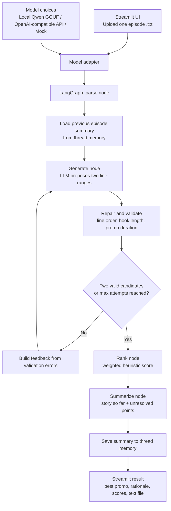

# Microdrama Promo Finder

A prototype that analyses a timestamped microdrama screenplay, proposes promo moments, validates their boundaries, and ranks the candidates. It is designed to reduce the amount of manual script review needed to find a strong hook followed by an unresolved cliffhanger.

> **Scope:** The app processes one episode per upload and selects the best valid candidate for that episode. It maintains a rolling story summary for later episodes in the same session. It does **not** currently generate a season-wide ranking or edit/render video clips.

## What it does

- Accepts one `.txt` episode screenplay through a Streamlit interface.
- Parses episode metadata and timestamped screenplay blocks.
- Keeps dialogue and action blocks for promo selection; camera and sound-effect blocks are excluded from the model's numbered candidate lines.
- Uses the current episode's logline, continuity notes, and the latest available earlier-episode summary as context.
- Asks the selected language model for two candidate promos, each represented by line numbers for a hook and a following cliffhanger.
- Repairs boundaries when a sentence is split across adjacent script lines, validates ordering and duration, and retries invalid output (up to two generation attempts).
- Scores valid candidates using a lightweight rule-based ranker and selects the higher-scoring candidate.
- Generates an updated story summary and stores it in the current LangGraph thread's memory.
- Displays the best promo and candidate scores, and saves a text output file in the selected output folder.

## Architecture



### Main components

| File | Responsibility |
|---|---|
| `app.py` | Streamlit UI, model selection, upload handling, thread IDs, and text output saving. |
| `graph.py` | Builds and runs the LangGraph workflow and exposes the saved thread memory. |
| `nodes.py` | Implements parse, generate, retry decision, rank, summarize, and save-memory nodes. |
| `script_parser.py` | Extracts episode metadata, timestamped blocks, and numbered dialogue/action lines. |
| `prompts.py` | Defines the promo-generation and rolling-summary prompts. |
| `schema.py` | Defines the expected structured response shapes and graph state. |
| `validator.py` | Repairs split-sentence boundaries and checks candidate line numbers and durations. |
| `ranker.py` | Scores candidates using explicit rules and returns the best index. |
| `model.py` | Common model interface with local GGUF, OpenAI-compatible API, and Mock implementations. |
| `config.py` | Central configuration for model defaults, promo duration, hook duration, and retry count. |

## Model and ranking logic

### Model options

The model layer exposes a shared `ask(system, user, schema)` interface, allowing the LLM to be changed without rewriting the graph:

1. **Local GGUF model:** `Qwen2.5-7B-Instruct-GGUF`, using the `Q4_K_M` file through `llama-cpp-python`. If no local path is entered, the app downloads the configured file from Hugging Face on first use.
2. **OpenAI-compatible API:** accepts a base URL, model name, and API key. This can point to a hosted provider or a compatible local server.
3. **Mock model:** intended only for checking that the application and graph run end to end. Its selected lines are rule-based and are not meaningful editorial recommendations.

### Candidate selection

The LLM returns line IDs rather than free-form timestamps. The application maps those IDs back to the original parsed blocks, preserving the source dialogue and timestamps. The candidate validator checks:

- `1 <= hook_from <= hook_to < cliffhanger_to <= number_of_lines`;
- hook duration does not exceed the configured limit;
- total promo duration is between 20 and 60 seconds;
- sentence fragments split across adjacent lines are not used as cut points where the repair rule can detect them.

The current maximum number of generation attempts is **2**. If no valid candidate is produced, the app reports that no valid promo was found for the episode.

### Rule-based ranking

The ranker does not make another LLM call. It scores each valid candidate using:

| Criterion | Weight | Current signal |
|---|---:|---|
| Hook | 35% | Intense tone words, question/exclamation punctuation, and whether the first block is spoken dialogue rather than an action. |
| Cliffhanger | 35% | Unresolved-looking ending punctuation, intense tone words, and a penalty for words associated with resolution. |
| Length | 15% | Full score for 30-45 seconds; otherwise a lower score. |
| Conflict | 15% | Frequency of speaker changes across the candidate. |

This is intentionally inexpensive and interpretable. It is a heuristic, not a trained ranking model or a guarantee that the selected clip is the most compelling to viewers.

## Input format

Upload one UTF-8 `.txt` screenplay per run. The parser expects the supplied screenplay structure, including:

- `EPISODE NUMBER: Episode N`
- `EPISODE LOGLINE: ...`
- `CONTINUITY NOTES: ...`
- labelled blocks such as `**CHARACTER:**`, `**ACTION:**`, `**CAMERA:**`, or `**SOUND FX:**`
- a timestamp line immediately after each block label, in the form `Start: (00:12.30) | End: (00:15.10)`

A simplified example:

```text
EPISODE NUMBER: Episode 1
EPISODE LOGLINE: A short description of the episode.
CONTINUITY NOTES: Relevant story context.

**MAYA:**
Start: (00:12.30) | End: (00:15.10)
You lied to me!

**ACTION:**
Start: (00:15.10) | End: (00:17.20)
Maya throws the letter onto the table.
```

The parser expects the same label / timestamp / text layout throughout the script. It sorts parsed blocks by start time and supplies dialogue and action blocks to the promo-generation prompt.

## Setup

### 1. Create and activate a virtual environment

**Windows PowerShell**

```powershell
py -m venv .venv
.venv\Scripts\Activate.ps1
```

**macOS / Linux**

```bash
python3 -m venv .venv
source .venv/bin/activate
```

### 2. Install dependencies

```bash
pip install -r requirements.txt
```

`llama-cpp-python` is required only for the local GGUF option. Depending on the operating system and hardware, installing a compatible build may require an additional setup step. The API option avoids downloading the local model.

### 3. Run the app

```bash
streamlit run app.py
```

Open the local Streamlit URL shown in the terminal, select a model in the sidebar, upload one episode `.txt` file, and click **Find promo**.

## Model configuration

- **Mock (test only):** no API key or local model file is needed. Use it to check the UI and graph flow only.
- **Local GGUF model:** choose the local option and either enter the path to a `.gguf` file or leave the path blank to use the configured Hugging Face repository/file.
- **API (OpenAI-compatible):** enter the provider's base URL, model name, and API key in the sidebar. The API key is entered as a password field and should not be committed to the repository.

The local model defaults are stored in `config.py`. Promo duration, maximum hook duration, context length, and retry count are configured there as well.

## Output

For a successful run, the interface shows:

- the selected promo's overall start and end timestamps and duration;
- the hook blocks and why the hook was selected;
- the cliffhanger blocks and why the ending may create curiosity;
- the available candidate promos and their component / total scores;
- the updated story summary, including unresolved story points.

A text file is written to the output folder (default: `promo_outputs`) using the name `output_of_<uploaded_filename>`. The UI's output-folder field can be changed for each run.

## Memory and episode continuity

Each browser tab is assigned a unique `thread_id`. LangGraph's checkpointer stores a summary by episode number within that thread. When a later episode is uploaded, the graph retrieves the latest summary from an earlier episode number and includes it in the prompt. The summary is updated after each run.

The current checkpointer is `InMemorySaver`. This is prototype memory, not durable database storage: restarting the app process clears it. The UI's **Clear memory** action starts a new thread with empty memory. There is not yet a named multi-chat interface for managing several shows from one screen.

## Current limitations

- One episode is uploaded at a time; the current result is the best promo for that episode, not a global ranking across a whole season.
- There is no database-backed persistence or in-app manager for multiple named show conversations.
- The parser assumes a uniform screenplay format and is currently designed for English-language scripts.
- The ranker uses keywords, punctuation, duration and speaker changes. It cannot reliably judge subtle emotional context, originality, or whether a new viewer understands the clip without prior context.
- A weak episode may not contain a sufficiently strong hook or cliffhanger. The system cannot create a compelling moment that is not present in the source.
- The promo validator currently accepts 20-60 seconds and the ranker prefers 30-45 seconds. The prompt describes a hook of at most 10 seconds, while the configured validator limit is 20 seconds; these hook rules should be made consistent.
- In `schema.py`, the top-level JSON Schema key `required` is misspelled as `reqired`; correct it before relying on strict schema enforcement.
- No measured accuracy, editor-agreement score, or production-scale latency / cost benchmark is claimed at this prototype stage.

## Further improvements

1. Add persistent show-level storage, named sessions, run history, and reviewer feedback.
2. Support batch processing across episodes and produce a season-wide ranked shortlist.
3. Calibrate ranking using editor-approved examples; measure acceptance rate, precision@K, reviewer agreement, and review-time reduction.
4. Add stronger semantic checks for first-three-second hooks, standalone context, and unresolved endings.
5. Improve parser robustness with format validation, timestamp sanity checks, edge-case tests, and controlled support for additional screenplay formats and languages.
6. Add export formats such as CSV / JSON so editors can hand selected timestamps to downstream editing tools.

## AI-assisted development

Claude was used mainly for problem breakdown, ideation, and exploring possible approaches. It was not used as an end-to-end developer: implementation, integration, and final design decisions were handled and checked by me. AI-generated suggestions were treated as drafts and checked against the actual code. One concrete issue that needed human checking was a mismatch between the prompt's 10-second hook target and the validator's 20-second configured limit. I also found a misspelled `required` key in the promo schema. Both should be corrected before production use.

## Confidentiality note

Do not commit Kuku's confidential screenplay input pack or any proprietary scripts to a public repository. Use synthetic examples in the README and keep real input files and generated raw outputs outside the public repo unless you have permission to share them.
